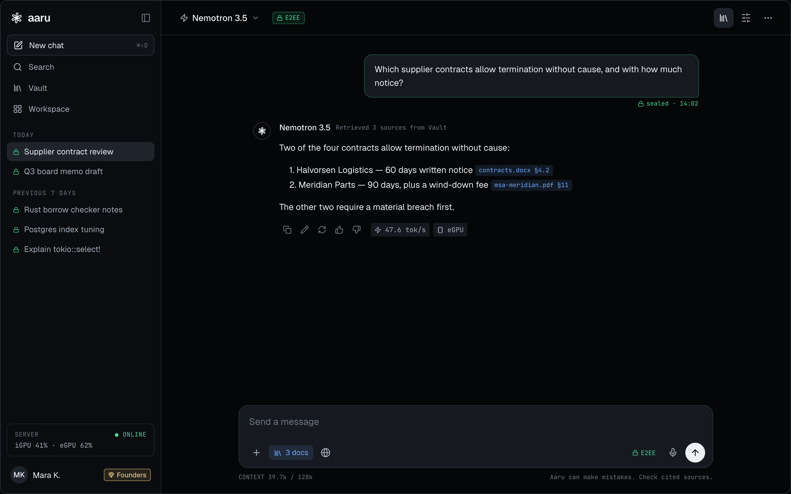
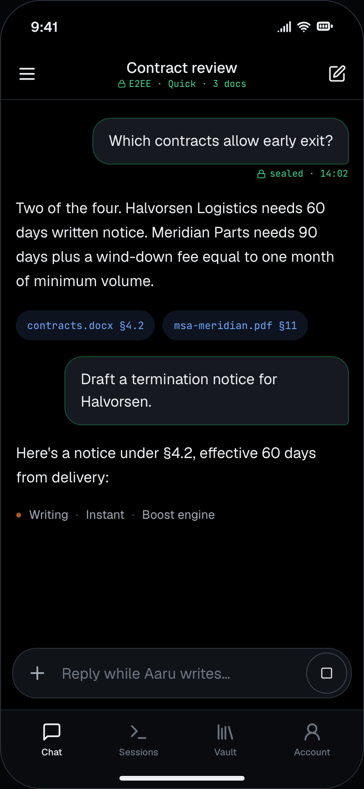
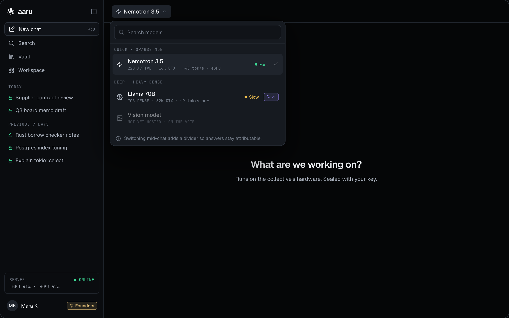
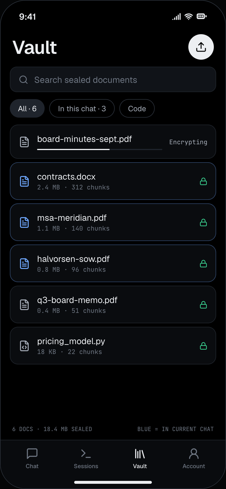
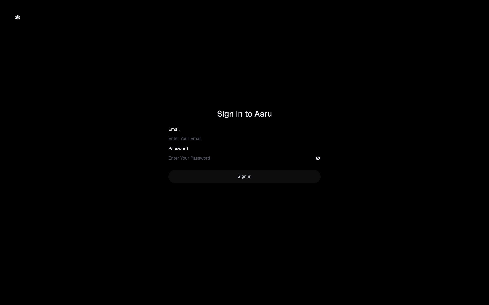
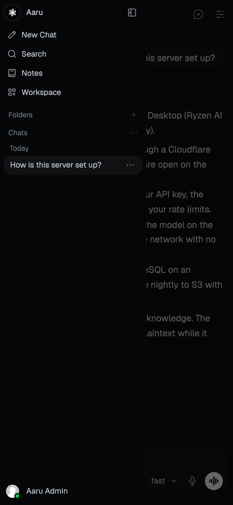

<p align="center">
  <picture>
    <source media="(prefers-color-scheme: dark)" srcset="design/design-system/assets/aaru-mark-white.svg">
    
  </picture>
</p>

<h1 align="center">aaru</h1>

<p align="center">
  Self-hosted AI inference on hardware you can name.<br>
  An OpenAI-compatible API and a web chat app, served from one host.
</p>

---

Aaru is an invite-only, single-host platform that runs open-weight language models on its own
hardware. Members reach the models through an
OpenAI-compatible API or through a web chat app that installs on phones as a PWA.

This repository holds the infrastructure (Podman Quadlet units, configuration, scripts), the build
specification, and the design system. It contains no model weights and no application server of its own.

> [!IMPORTANT]
> **Aaru's web app is based on [Open WebUI](https://github.com/open-webui/open-webui).** It started
> from Open WebUI 0.12.3, created by Timothy Jaeryang Baek and the Open WebUI contributors, and now
> lives in its own repository, [`CorpLynx/aaru-web`](https://github.com/CorpLynx/aaru-web), where it
> will diverge as Aaru grows. Every change from Open WebUI is listed in
> [`AARU.md`](https://github.com/CorpLynx/aaru-web/blob/main/AARU.md). The code remains under the
> [Open WebUI License](https://github.com/CorpLynx/aaru-web/blob/main/LICENSE); the rebrand relies on
> its clause 4(i), which permits it for deployments with at most 50 end users in any rolling 30-day
> period. Aaru stays under that cap; above it the original branding must return.

## Design

<table>
  <tr>
    <td width="70%"></td>
    <td width="30%"></td>
  </tr>
  <tr>
    <td></td>
    <td></td>
  </tr>
</table>

> [!NOTE]
> These are design mockups from [`design/`](design/README.md), not screenshots of the running product.
> They show features that are not built yet and claims that are not true yet: end-to-end encryption
> ("E2EE", "sealed"), the document Vault, the named models and an external GPU.
> Which of these ship is still open; see §7a of the
> [build specification](architecture.md#7a-product-design-and-surfaces).

### Current build

<table>
  <tr>
    <td width="70%"></td>
    <td width="30%"></td>
  </tr>
  <tr>
    <td></td>
    <td></td>
  </tr>
</table>

<sub>The web app as it runs today (<code>aaru-web</code> <code>main</code>): the Aaru theme, fonts and branding on Open WebUI's screens. Captured from a local test instance with a stub model, so the reply is illustrative. Phone shots are the web app at 390×844, the size it runs at when installed as a PWA.</sub>

## How it works

```text
API clients ─> Cloudflare edge ─> cloudflared ─> LiteLLM ─> llama-swap ─> llama.cpp (Vulkan)
Browsers / PWA ─> Cloudflare edge ─> cloudflared ─> Aaru web app (aaru-web) ─> LiteLLM
Interim, until Cloudflare is live: members ─> Tailscale (shared node) ─> tailscale container ─> web app / LiteLLM /v1
                                                         └─> PostgreSQL (encrypted volume)
```

| Layer | Project | Role |
| --- | --- | --- |
| Containers | [Podman](https://github.com/containers/podman) + Quadlet | Rootless containers as systemd units, SELinux enforcing |
| Ingress | [cloudflared](https://github.com/cloudflare/cloudflared); [Tailscale](https://tailscale.com) in the interim | Outbound tunnel; no inbound ports open on the host. Until Cloudflare is live, members reach a shared Tailscale node |
| Gateway | [LiteLLM](https://github.com/BerriAI/litellm) | Per-member virtual keys, model allowlists, rate limits, usage |
| Inference | [llama.cpp](https://github.com/ggml-org/llama.cpp) behind [llama-swap](https://github.com/mostlygeek/llama-swap) | Models load on first request and unload when idle; Vulkan in production; [vLLM](https://github.com/vllm-project/vllm) on CUDA for interim testing |
| Web app | [aaru-web](https://github.com/CorpLynx/aaru-web), based on [Open WebUI](https://github.com/open-webui/open-webui) | Chat, history, PWA |
| Database | [PostgreSQL](https://www.postgresql.org/) | Separate database and least-privilege role per service |
| Logs | [Dozzle](https://github.com/amir20/dozzle) | Live log viewer, admin network only |

Containers sit on three networks. `aaru-ingress` (cloudflared, LiteLLM, web app) has internet access.
`aaru-internal` (PostgreSQL, inference) has none, and has DNS disabled so ingress-only containers have
no route into it. `aaru-admin` holds Dozzle alone.

## Privacy, plainly

- Data at rest is planned for an encrypted volume (LUKS), and backups go to S3 encrypted with a
  customer-managed KMS key.
- Prompts and API keys are kept out of logs; `verify.sh` checks this.
- **Aaru is not zero-knowledge.** The web app, gateway and model handle your prompts in plaintext
  while they work, and the operator of the host could read stored chats. Cloudflare terminates TLS at
  its edge. See §8 of the [build specification](architecture.md#8-security-and-privacy-model).

## Status

**Phase 0: hardware and model proof.** The stack is being validated on interim hardware
(vLLM on CUDA) while the production host is set up.

| Area | State |
| --- | --- |
| Quadlet units, network segmentation, per-service database roles | Written and hardened (capabilities dropped, read-only roots); test-box run pending |
| Encrypted S3 backups | Script, units and Terraform stack written; first run and restore drill pending |
| Web app theme and branding | Done in [`aaru-web`](https://github.com/CorpLynx/aaru-web) |
| Image pipeline (GitHub Actions, Trivy-gated, digest-pinned) | First build blocked by the Trivy gate; dependency fixes in aaru-web #36 |
| Host hardening, member keys, model fetch, health alerts | Scripts written; not yet run on a host |
| Restore drill, Tailscale admin access | Next |
| Encrypted storage from the design handoff | Waiting on open decisions 10, 13 and 14 in the spec |

## Repository layout

```text
aaru/
├── architecture.md                         Build specification: architecture, security, phases, decisions
├── design/                                 Design handoff: design system, surface specs, HTML references
├── docs/                                   Screenshots and, later, product and operator docs
├── infra/
│   ├── quadlet/                            Podman Quadlet units and networks
│   ├── config/                             LiteLLM config, PostgreSQL init script
│   ├── scripts/                            setup, hardening, members, models, backup, health, verify
│   └── terraform/                          S3 state bucket, Cloudflare zone and tunnel, backup bucket
└── web/                                    Local clone of CorpLynx/aaru-web (own repository, ignored here)
```

## Operating it

Once, as the admin user (dry run first; `--apply` makes the changes):

```sh
sudo infra/scripts/harden-host.sh --admin-user <admin> --ssh-from <cidr|interface>
```

It also sets up a weekly Lynis audit; its summary appears in the login banner for admins.

On the Fedora host, as the unprivileged `aaru` service user:

```sh
infra/scripts/fetch-models.sh          # the model catalog: pinned, hash-checked, Anubis-scanned
infra/scripts/setup.sh                  # installs units and host drop-ins, prints the secrets to create
infra/scripts/member.sh add <email>     # one LiteLLM key per invited member; also list, rotate, revoke
infra/scripts/member.sh webapp-key      # the web app's own key, stored as a Podman secret
infra/scripts/healthcheck.sh --print    # what the 5-minute health timer sees
infra/scripts/verify.sh                 # checks the Phase 1 acceptance criteria
```

Host-specific settings are not in git: copy `infra/quadlet/<unit>.container.d/local.conf.example`
(memory limit), `infra/config/llama-swap/config.yaml.example` (the models llama-swap may load) and
`infra/config/litellm/models.yaml.example` (which model backs each alias), then fill them in.

Models come only from official sources (the author's org, or ggml-org where the author publishes no
GGUF) and are listed in `infra/config/models.catalog`. Every new GGUF is scanned by
[Anubis](https://github.com/CorpLynx/Anubis) when it is fetched; one that fails is quarantined, not
installed. Anubis runs only then, not during normal operation.

From another machine:

```sh
infra/scripts/verify.sh --outside <host-ip> --api-url https://api.<domain>
infra/scripts/build-openwebui-image.sh  # builds the web app image on GitHub Actions and pins its digest
```

`verify.sh` checks SELinux, firewalld, open ports, container hardening, network isolation and egress,
database roles, key enforcement, model allowlists, rate limits, streaming, and that no prompt text or
keys reach the logs.

## Hardware

- One host with an AMD GPU, served through llama.cpp on Vulkan
- Fedora Server with SELinux enforcing
- An NVIDIA test machine (vLLM on CUDA) for interim validation

## Documentation

- [Build specification](architecture.md): architecture, security model, delivery phases, open decisions
- [Design handoff](design/README.md): brand, tokens, components and surface specs; §7a of the spec lists where it differs from v1 scope
- [aaru-web](https://github.com/CorpLynx/aaru-web): the web app, and [`AARU.md`](https://github.com/CorpLynx/aaru-web/blob/main/AARU.md) for every change from Open WebUI

## License

This repository has no license yet. The web app is governed by the
[Open WebUI License](https://github.com/CorpLynx/aaru-web/blob/main/LICENSE) (BSD-3-Clause plus a
branding clause). Geist and JetBrains Mono are under the SIL Open Font License 1.1. Every other
component keeps its own license; see the table above.
